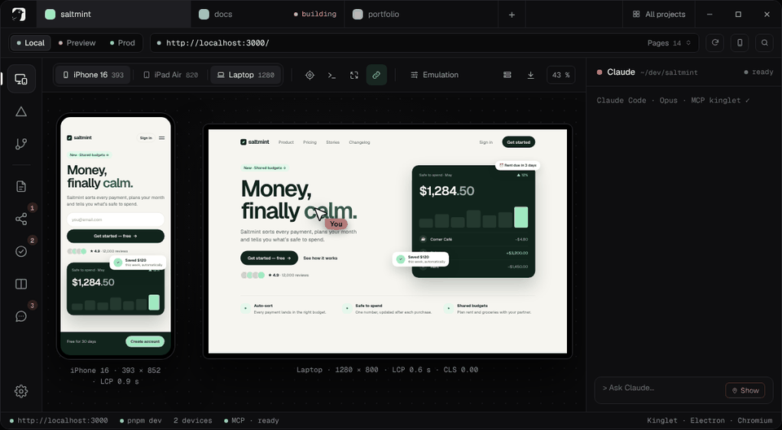
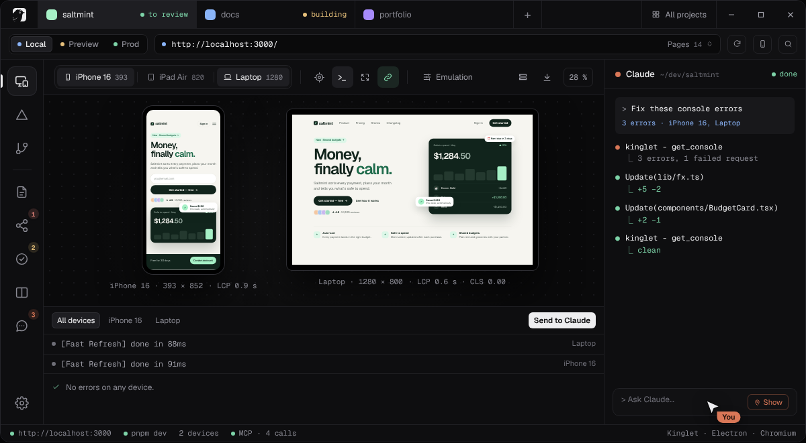
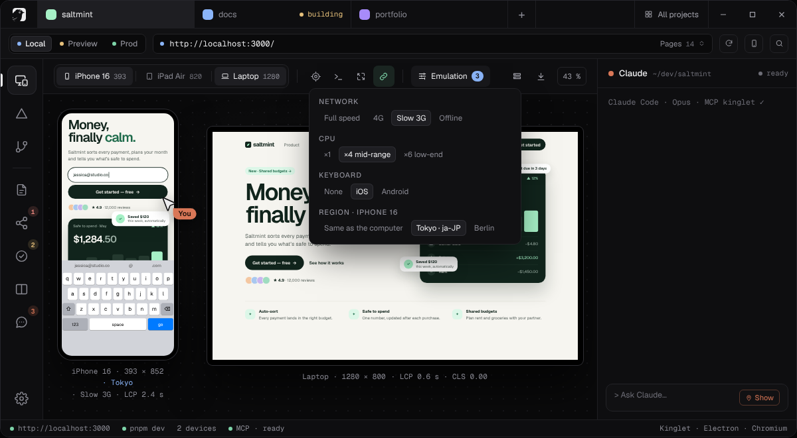
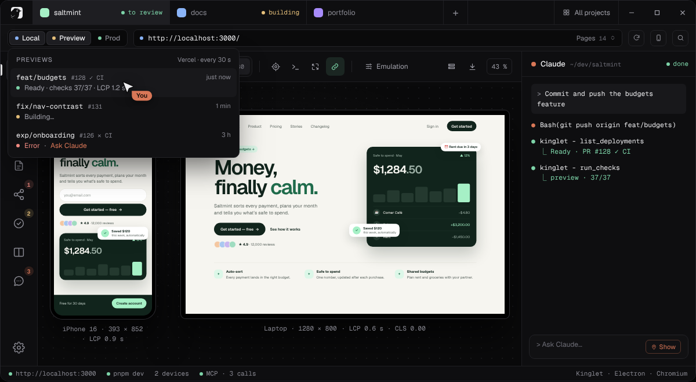
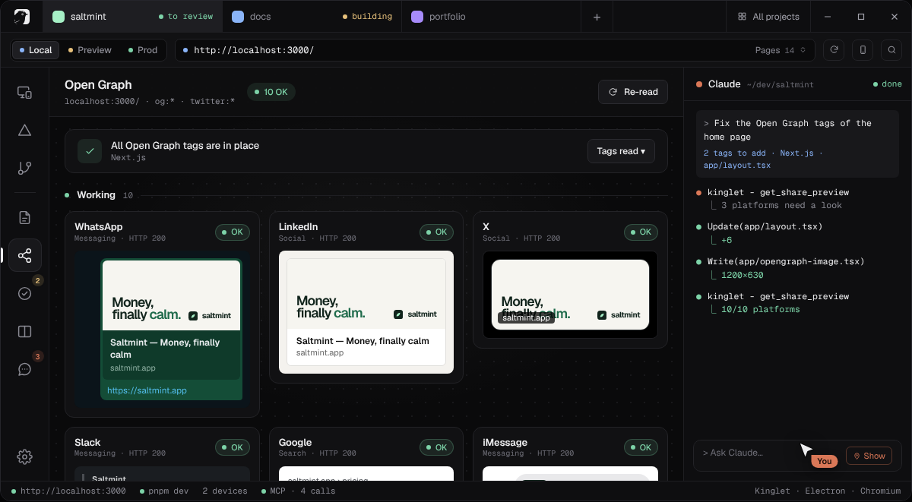

<p align="center">
  <a href="https://getkinglet.com">
    <picture>
      <source media="(prefers-color-scheme: dark)" srcset=".github/assets/logo-white.png">
      
    </picture>
  </a>
</p>

<h3 align="center">The dev environment for vibe coding.</h3>

<p align="center">
  Build with Claude, watch it land on 10 devices at once, point at what’s wrong and let Claude fix it.<br>
  Then ship through GitHub and Vercel with 37 checks watching your back.
</p>

<p align="center">
  <a href="https://github.com/stevenpersia/kinglet-releases/releases/latest"></a>
  
  
  <a href="https://getkinglet.com/#pricing"></a>
</p>

<p align="center">
  <a href="https://github.com/stevenpersia/kinglet-releases/releases/latest"><b>Download</b></a> ·
  <a href="https://getkinglet.com"><b>Website</b></a> ·
  <a href="#install">Install</a> ·
  <a href="#claude-code-mcp">Claude Code</a> ·
  <a href="https://github.com/stevenpersia/kinglet-releases/releases">Changelog</a>
</p>

<br>

<p align="center">
  
</p>

<p align="center"><sub>Inspect a button on every device → <b>Ask Claude</b> → Enter → fixed and checked on both screens.</sub></p>

<br>

## 01 · AI workflow — point at it, Claude fixes it

A real Claude Code terminal lives next to your devices, with Kinglet’s MCP server already plugged in. Anything you see can become a prompt, with the screenshot and the element attached.

- **Inspect → Ask Claude.** Hover an element: it lights up on every device, with its size, margins, font and color. One click sends the table and a capture to Claude.
- **Console → Send to Claude.** Errors and failed requests from every device, in one drawer. Claude fixes them, then reads the console again.
- **Claude, tracked.** Each project tab says *working*, *waiting for you* or *to review*, with a notification when a task ends.
- **New project.** Name it, Claude proposes a stack, the dev server starts on its own, then one click creates the GitHub repository and the Vercel project.

<p align="center"></p>

## 02 · Device lab — on your desk

Real emulation through Chromium’s DevTools protocol (width, density, touch, user agent). Every tool applies to every device at once.

| | |
|---|---|
| **10 devices, side by side** | iPhone, Pixel, Galaxy, iPads, laptop, desktop or your own, portrait or landscape |
| **Synced scroll and navigation** | scroll or click on one, every other device follows; DevTools on each |
| **On your real phone** | a QR code opens `localhost` over Wi-Fi, hot reload included |
| **Network and CPU throttling** | 4G, slow 3G, mid-range ×4 or low-end ×6 CPU |
| **Appearance** | dark mode, reduced motion, high contrast, text at 130–200 %, page zoom 200 % |
| **Region per device** | language, timezone and location: the iPhone in Tokyo, the iPad in Berlin |
| **Virtual keyboards** | iOS or Android keyboard drawn on the page, `visualViewport` shrinks like on a phone |
| **Form filler** | valid or junk data in every field, lists the fields with no validation |
| **Offline and API mocks** | cut the network or fake any endpoint: status, delay, body |
| **Export** | PNG board, PDF, full pages up to 10,000 px, WebM or GIF |
| **Feedback and review links** | pin comments on devices, send a link to a client: no app, no account |

<p align="center"></p>

## 03 · Vercel & GitHub — local, preview, prod, one click apart

- The same page on your dev server, any Vercel preview (by branch) or production.
- Deployments live, with each branch’s **pull request** and its **CI**; protected previews open without a login wall.
- **Compare** environments: tags and check scores side by side, changed pixels in red, LCP, CLS and TTFB.
- **History**: every Ready deploy and every local commit measured on a phone; **performance budgets** per path.

<p align="center"></p>

## 04 · Checks & audits — 37 checks, on every render

SEO, Open Graph, mobile, accessibility (axe-core, visible focus, keyboard path) and technical (JS errors, image weight, LCP, CLS), measured inside the devices. A **whole-site audit** reads up to 300 pages like Google: broken links, dead anchors, duplicate titles, sitemap gaps, one-way hreflang.

**Open Graph**: every preview at a glance (WhatsApp, iMessage, Slack, Discord, Telegram, LinkedIn, X, Facebook, Bluesky, Google), each read by its own bot without JavaScript, problems first, with the fix for your framework (Next.js, Nuxt, Astro, SvelteKit, Vite).

<p align="center"></p>

## Claude Code (MCP)

Your terminal Claude gets eyes too: 13 tools and 5 slash commands. It screenshots devices, runs checks, audits the site and verifies its own fix. Works with the app closed, on any URL.

```bash
claude mcp add --scope user kinglet -- kinglet --mcp --ozone-platform=headless
```

`status` · `open_url` · `set_devices` · `screenshot` · `get_page_meta` · `get_share_preview` · `run_checks` · `audit_site` · `get_accessibility` · `get_structured_data` · `list_pages` · `list_deployments` · `get_console`

`/mcp__kinglet__fix_share` · `/mcp__kinglet__fix_checks` · `/mcp__kinglet__fix_console` · `/mcp__kinglet__fix_site` · `/mcp__kinglet__fix_accessibility`

## Install

Download the latest version from **[Releases](https://github.com/stevenpersia/kinglet-releases/releases/latest)**.

**Arch, CachyOS (pacman)**

```bash
sudo pacman -U Kinglet-*.pacman
```

**Any distribution (AppImage)**

```bash
chmod +x Kinglet-*.AppImage
```

```bash
./Kinglet-*.AppImage
```

Kinglet runs on Wayland natively. It finds a dev server already running (ports 3000, 5173, 4321, 8080…) or takes any address.

**Updates** are automatic: the app checks at startup and every 6 hours, downloads in the background, verifies the file (SHA-512) and installs only when you click **Install and restart**.

## Pricing

**€49, once.** No subscription, no account, no seat to manage. One license, every feature. → [getkinglet.com](https://getkinglet.com/#pricing)

## About this repository

The source code is private. This repository holds the public releases (AppImage, pacman package and `latest-linux.yml`, which the app reads to update itself).

<br>

<p align="center"><sub>Kinglet · made for sites built with Claude · <a href="https://getkinglet.com">getkinglet.com</a></sub></p>
